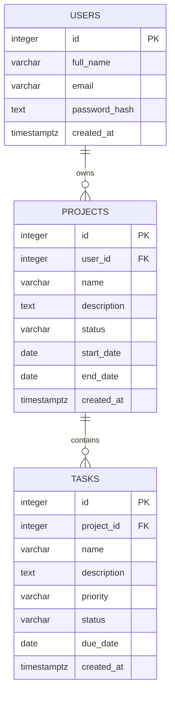

# ProjectFlow — Entity Relationship Diagram

The diagram below represents the database tables and their verified foreign-key relationships.

## Relationship explanation

- **Users to Projects:** One user can own multiple projects. Each project references its owner through `projects.user_id`.
- **Projects to Tasks:** One project can contain multiple tasks. Each task references its project through `tasks.project_id`.

## Cardinality

- `users.id` → `projects.user_id`: one-to-many.
- `projects.id` → `tasks.project_id`: one-to-many.

The foreign keys were verified against the PostgreSQL database.
